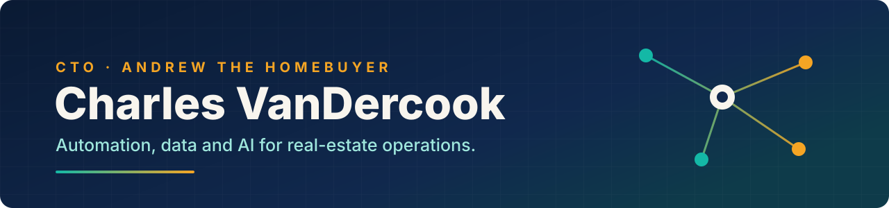

<p align="center">
  
</p>

<p align="center">
  <a href="https://github.com/Andrew-The-Homebuyer-ATHB"></a>
  
</p>

### 👋 Hi, I'm Charles

I lead technology at **[Andrew The Homebuyer](https://github.com/Andrew-The-Homebuyer-ATHB)**, a
direct-to-seller home buyer. My job is to take the work off the team's plate: the automations, the CRM,
the data, and the AI that sits on top. People then spend their time on sellers, not on spreadsheets.

### 🛠️ What I'm working on

- **Automation that pays for itself.** I'm rebuilding our automation stack so it is faster, cheaper
  to run, and doesn't break at 2 a.m.
- **One lead database.** Every call, form and email lands in a single source of truth, feeding live
  dashboards.
- **CRM that runs itself.** Pipeline stages, tasks and hand-offs in Follow Up Boss, wired end to end.
- **Tools for the industry.** Proven on our own deal floor first, then shaped so other wholesale
  real-estate teams can use them too.

### ⚙️ How I build

```text
automate the repeatable  ·  measure the savings  ·  keep seller data private  ·  make every change reversible
```

### 🧰 Toolbox

<p>
  
  
  
  
  
  
  
  
</p>

<p align="center"><sub>Building in the open where it helps the industry, and in private where it protects our sellers.</sub></p>
